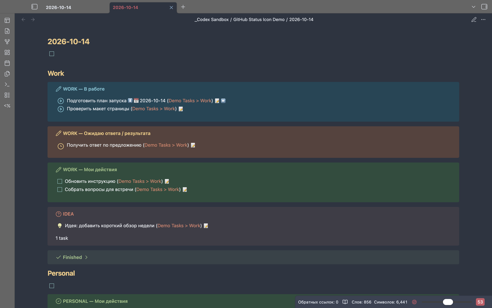
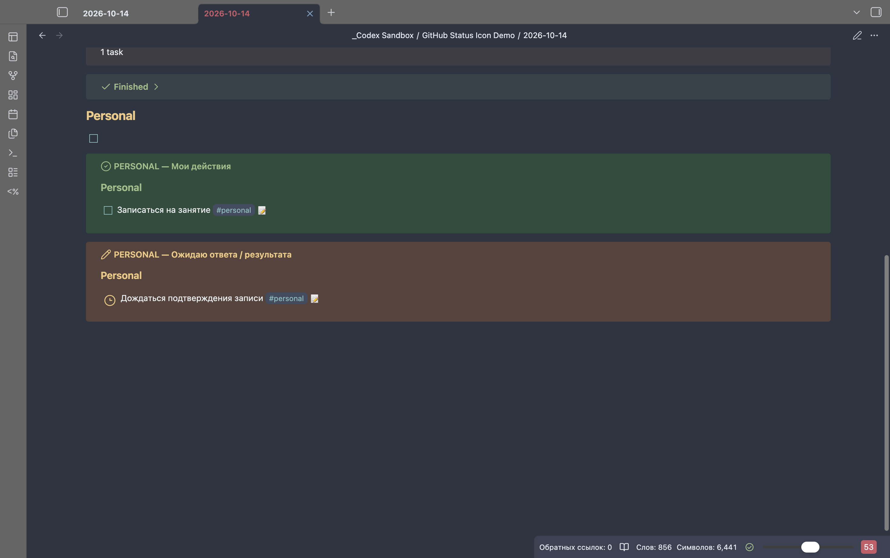
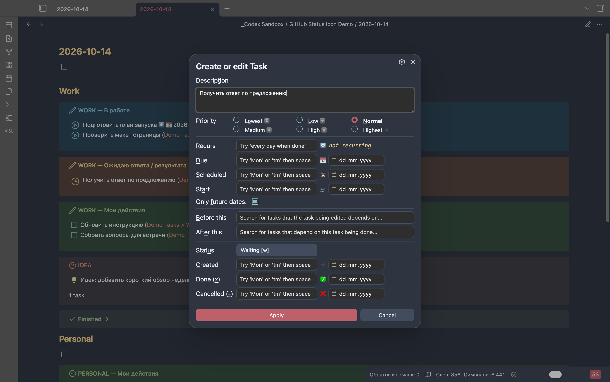

# Obsidian Kung Fu

Моя связка Obsidian для заметок и задач: быстрый ввод в ежедневнике, списки по статусам и редактирование прямо из этих списков.

Задачи остаются в обычных Markdown-файлах. Ежедневник собирает нужные задачи из разных заметок — переносить незавершённое вручную не нужно.

## Мои плагины

| Плагин | Что делает | Установка и исходники |
| --- | --- | --- |
| [Daily Checkbox Focus](https://obsidian.md/plugins?id=daily-checkbox-focus) | При открытии ежедневника ставит курсор в первый пустой чекбокс. По умолчанию ищет его до первого заголовка и добавляет, если такого чекбокса нет. Можно сразу писать новую задачу. | [Каталог Obsidian](https://obsidian.md/plugins?id=daily-checkbox-focus) · [GitHub](https://github.com/GeoKhv/obsidian-daily-checkbox-focus) · [Релизы](https://github.com/GeoKhv/obsidian-daily-checkbox-focus/releases/latest) |
| [Tasks Inline Edit](https://obsidian.md/plugins?id=tasks-inline-edit) | Позволяет менять текст задачи прямо в результатах Tasks. Показывает под подзадачей цепочку родителей, даже если они находятся в других списках по статусу. Клик по родителю открывает его строку в редакторе. | [Каталог Obsidian](https://obsidian.md/plugins?id=tasks-inline-edit) · [GitHub](https://github.com/GeoKhv/obsidian-tasks-inline-edit) · [Релизы](https://github.com/GeoKhv/obsidian-tasks-inline-edit/releases/latest) |

В Tasks Inline Edit контекст включён по умолчанию. Его можно выключить в **Настройки → Tasks Inline Edit → Показывать контекст родительских задач**. Настройка применяется сразу и сохраняется после перезапуска.

## Что умеет daily v2

- Собирает задачи из исходных заметок, сохраняя ссылки на них. Общий ввод новых задач остаётся сверху ежедневника.
- Разделяет WORK на «В работе» (`[/]`), «Ожидаю ответа / результата» (`[w]`) и «Мои действия» (`[ ]`), в таком порядке.
- Отделяет PERSONAL по тегу `#personal`, его вложенным тегам и личным заголовкам; показывает действия и ожидания отдельно.
- Переносит задачу между списками при смене статуса. Waiting остаётся незавершённой; нажатие её чекбокса возвращает задачу в Todo.
- Выделяет работу голубым, ожидания янтарным, действия зелёным. «В работе» обозначается ▶ в кружке, Waiting — часами. Панель поиска/копирования и заголовки WORK-групп без тегов скрыты.
- Сохраняет IDEA, Finished, фильтры дат действий и сортировку по срочности/приоритету. Ожидания показываются независимо от дат.
- Показывает вложенные задачи отдельными строками, сохраняя исходную вложенность Markdown. ARCHIVE/templates и пустые чекбоксы исключены из открытых списков.
- При установленном Tasks Inline Edit текст задачи можно менять прямо в выдаче: `Enter` сохраняет, `Escape` отменяет. Запись меняет описание исходной задачи.
- Подзадачи сохраняют собственные статусы. Tasks Inline Edit показывает цепочку родителей, даже когда они находятся в других списках; клик по предку открывает его точную строку.

## Кто за что отвечает

| Компонент | Роль |
| --- | --- |
| [Tasks](https://github.com/obsidian-tasks-group/obsidian-tasks) | Статусы, даты, приоритеты, фильтры, сортировка и результаты запросов. |
| [Daily Notes](https://help.obsidian.md/plugins/daily-notes) | Создание и открытие ежедневников с именем `YYYY-MM-DD` по выбранному шаблону. |
| [Шаблон daily v2](templates/daily-v2.md) | Верхняя область ввода, WORK/PERSONAL, запросы по статусам, IDEA и Finished. |
| [Daily Checkbox Focus](https://obsidian.md/plugins?id=daily-checkbox-focus) | Фокус на пустом чекбоксе для быстрого ввода. Не зависит от Tasks. |
| [Tasks Inline Edit](https://obsidian.md/plugins?id=tasks-inline-edit) | Правка текста в выдаче Tasks и контекст подзадач. Требует Tasks. |
| [Daily Task Blocks.css](snippets/Daily%20Task%20Blocks.css) | Цвета блоков и иконки «В работе» / «Ожидание». |
| Obsidian Nord + Style Settings + S - Checkboxes | Тема и дополнительные настройки оформления моей установки. |

Также у меня включены Templater, Advanced URI, Editor Width Slider, Excel to Markdown Table, Kanban и Dataview. Они дополняют работу с заметками; списки задач из `daily v2` построены на Tasks. Наличие Templater не означает, что шаблон требует его: здесь используются переменные `{{title}}`, которые подставляет механизм создания ежедневной заметки.

## Пример

В исходной заметке:

```md
- [/] Подготовить шаблон проекта
    - [x] Обсудить структуру ✅ 2026-10-14
    - [ ] Отправить участникам
```

В списке «Мои действия»:

```text
☐ Отправить участникам
  ↳ Подготовить шаблон проекта
```

Обсуждение при этом находится в Finished за день завершения, а родитель — в «В работе». Подпись не меняет статусы и не подтягивает остальные подзадачи в этот список.

## Скриншоты

Снимки настоящего Obsidian на macOS: Tasks 8.5.0, тёмная тема Obsidian Nord и включённый snippet. Все задачи демонстрационные; для снимков запросы ограничены тестовой заметкой. Значки «В работе» и Waiting входят в `daily-v2-callouts.css`; остальные значки чекбоксов зависят от темы и дополнительных CSS snippets.

**WORK:** работа → ожидания → следующие действия. Поиск и «Без тегов» скрыты.



**PERSONAL:** личные действия и ожидания в разных блоках.



**Waiting:** выбор статуса в стандартном редакторе Tasks после его регистрации в настройках.



## Шаблоны

| Шаблон | Назначение |
| --- | --- |
| `templates/daily-v2.md` | Общий ввод сверху, WORK/PERSONAL, отдельные «Мои действия» и «Ожидаю ответа / результата», IDEA и общий Finished. WORK расположен в порядке «В работе» (In Progress) → «Ожидаю» (Waiting) → «Мои действия» (Todo). |
| `templates/person.md` | Карточка человека. |
| `templates/project.md` | Карточка проекта с Tasks-запросами; Unfinished исключает ON_HOLD. |
| `templates/wiki.md` | Справочная заметка. |

Файл `templates/daily v2.md` сохранён как совместимое имя уже опубликованного шаблона; его содержимое совпадает с `templates/daily-v2.md`.

Для ежедневных заметок используйте `daily-v2.md`. Шаблон не требует копирования задач между заметками: запросы читают исходные строки во всём vault и сохраняют ссылки на них.

## Установка daily v2

1. Скопируйте `templates/daily-v2.md` в папку `templates` вашего vault.
2. Включите встроенные **Daily notes** и **Templates**. Для Templates укажите папку `templates`.
3. В Daily notes задайте формат имени `YYYY-MM-DD`, папку `daily` и шаблон `templates/daily-v2.md`.
4. Установите и включите [Obsidian Tasks](https://publish.obsidian.md/tasks/Introduction). Полная исходная проверка выполнена с Tasks **8.4.0** и Obsidian **1.13.7** на macOS. После обновления до Tasks **8.5.0** дополнительно проверены запросы, разделение демонстрационных задач, редактор Waiting и текущий вид списков; другие версии отдельно не проверены.
5. Настройте статусы и даты по инструкции ниже. Перезагрузите Tasks или Obsidian после изменения статусов.
6. Создайте заметку через Daily notes. `{{title}}` должен превратиться в дату имени файла. Простое копирование текста шаблона не подставляет дату; не оставляйте буквальный `{{title}}` в готовой заметке.

Для запросов не нужны Dataview, Templater или Tasks Inline Edit. [Daily Checkbox Focus](https://obsidian.md/plugins?id=daily-checkbox-focus) — необязательный плагин для автоматического перехода к верхнему пустому чекбоксу. Для него используйте режим поиска *Before first heading* (`top-capture`) и оставьте строку `- [ ] ` перед первым заголовком. Проверен установленный Daily Checkbox Focus 1.2.1. Оформление и значки статусов зависят от темы/CSS; функциональность Waiting не требует специального значка.

[Tasks Inline Edit](https://obsidian.md/plugins?id=tasks-inline-edit) добавляет редактирование в выдаче и контекст подзадач. Установите и включите его через **Настройки → Сторонние плагины → Обзор**. Контекст включён по умолчанию; переключатель **Показывать контекст родительских задач** в настройках плагина применяется сразу и сохраняется после перезапуска. Подробности и ограничения — в [описании рабочего сценария](docs/task-workflow.md).

## Цвета блоков и значки статусов

В шаблоне есть метки ролей: `task-progress` для «В работе», `task-waiting` для ожиданий и `task-todo` для «Моих действий». Они не влияют на Tasks-запросы.

Копия CSS по прежнему адресу [snippets/Daily Task Blocks.css](snippets/Daily%20Task%20Blocks.css) сохранена с тем же содержимым.

Для оформления скопируйте [daily-v2-callouts.css](templates/daily-v2-callouts.css) в `.obsidian/snippets/Daily Task Blocks.css` вашего vault. В **Settings → Appearance → CSS snippets** обновите список и включите **Daily Task Blocks**. Это стандартный механизм [CSS snippets Obsidian](https://help.obsidian.md/snippets); дополнительный плагин не нужен.

В тёмной теме фон «В работе» голубой (`#294455`), ожиданий янтарный (`#55432A`), действий зелёный (`#344C36`). Заголовки используют соответствующие цвета Nord. Для светлой темы предусмотрены светлые фоны и более тёмные заголовки. Те же роли применяются к PERSONAL. Обычные callouts, IDEA, Finished и темы не переопределяются.

Snippet также заменяет значки двух незавершённых статусов: `[/]` — голубой ▶ в контурном кружке, `[w]` — янтарные контурные часы. В Tasks-запросах значок определяется и по типу `IN_PROGRESS`/`ON_HOLD`; в исходных строках используются символы `/` и `w`. Если для Waiting выбран другой символ, замените `data-task="w"` в CSS на свой. Это оформление действует во всём vault, в обычных списках и результатах Tasks, в чтении и Live Preview. Оно сохраняет настоящие чекбоксы и их нажатия; Todo, Done и остальные статусы не меняются. Значки встроены в CSS, отдельный иконочный шрифт не нужен.

Например, заголовок `> [!DO|task-progress] WORK — В работе` включает голубое оформление. Без snippet блоки остаются функциональными и используют стандартный вид темы. Исторические заметки автоматически не получают новые метки.

Snippet и его включение могут синхронизироваться через Obsidian Sync, если на каждом устройстве разрешена синхронизация **Themes and snippets** и **Appearance**. После получения изменений перезапустите приложение при необходимости.

В daily v2 панель поиска и копирования скрыта командой `hide toolbar` во всех семи списках. В WORK задачи без тегов отображаются без отдельного заголовка; заголовки групп с тегами сохраняются. Эти настройки не меняют состав задач.

## Обязательные настройки Tasks

- **Global filter** и **Global query** оставьте пустыми для воспроизведения этого шаблона. Иначе они дополнительно ограничат каждый запрос, включая ожидания. Например, глобальный `status.type is not ON_HOLD` полностью скроет Waiting.
- Используйте формат задач **Tasks Emoji Format**.
- Включите **Use filename as Scheduled date**, формат `YYYY-MM-DD` (пустое поле формата использует этот формат по умолчанию), без ограничений папок для поведения исходной конфигурации. Без этой настройки недатированные рабочие задачи могут не пройти сохранённый фильтр `starts on or before`; PERSONAL допускает задачи без дат.
- Включите **Set done date on every completed task** и **Set cancelled date on every cancelled task**. Finished ищет именно дату завершения/отмены, совпадающую с именем daily.
- JavaScript-фильтры и сортировки `filter/group/sort by function` должны быть доступны. Шаблон использует `moment` в сортировке срочности WORK.
- Core-статусы: Todo `[ ]` — `TODO`, Done `[x]` — `DONE`. Добавьте In Progress `[/]` — `IN_PROGRESS`, Cancelled `[-]` — `CANCELLED`, если их ещё нет. Рекомендуемые следующие символы: Todo → `x`, In Progress → `x`, Done → пробел, Cancelled → пробел.

**Set created date** необязателен для фильтров; в проверенной конфигурации он включён. Автоподсказки тоже необязательны.

## Статус Waiting

В **Settings → Tasks → Statuses → Custom statuses** добавьте:

| Поле | Значение |
| --- | --- |
| Symbol | `w` |
| Name | `Waiting` |
| Type | `ON_HOLD` |
| Next status symbol | пробел — Todo |
| Available as command | включено |

Сначала проверьте, свободен ли `w`. Если он занят, выберите другой свободный символ и используйте его в исходных строках. Запросы фильтруют по типу `ON_HOLD`, поэтому менять их не потребуется. Не переопределяйте Rescheduled `[>]` или другие существующие статусы. Если Rescheduled нужен в новом vault, его прежний тип — `TODO`.

Waiting остаётся незавершённой задачей. Обычное нажатие чекбокса Waiting возвращает её в Todo; следующее нажатие Todo завершает её. Через редактор Tasks, контекстное меню статуса или команды можно выбрать In Progress или Done напрямую. Переход в Done через Tasks ставит дату завершения автоматически.

## Создание задач

В верхнем блоке daily записывайте обычные задачи:

```markdown
- [ ] Подготовить предложение
- [/] Дописать предложение
- [w] Ожидаю ответа от контрагента по предложению
- [ ] Записаться на занятие #personal
- [w] Ожидаю подтверждения записи #Personal/health
```

Имя человека и ожидаемый результат указывайте в **Description**, то есть в тексте задачи. Отдельной системы ответственных нет. Пустые чекбоксы не попадают в результаты.

Когда ответ пришёл и следующий шаг за вами, смените `[w]` на `[ ]` или `[/]`. Задача уйдёт из ожиданий в действия, если проходит прежние фильтры дат. При завершении через Tasks выберите `[x]`; она исчезнет из открытых списков и попадёт в Finished за день завершения. При ручном вводе `[x]` добавьте дату `✅ YYYY-MM-DD`, иначе Finished не сможет определить день завершения.

## WORK и PERSONAL

**WORK** принимает задачи текущей daily, задачи из папки `daily` и задачи под заголовками, содержащими `work`. Из них исключается личная классификация.

**PERSONAL** принимает задачи с точным тегом `#personal` или вложенным тегом `#personal/...`, без учёта регистра. `#personality` и `#personalized` не считаются личными. Дополнительно сохраняется классификация по заголовкам, содержащим `personal`, `todo.family`, `life` или `hobbies`, также без учёта регистра. Личная классификация имеет приоритет над рабочей.

В пяти открытых списках исключаются папки с сегментами `ARCHIVE` и `templates` в любом регистре. WORK сортирует действия по сочетанию приоритета и срочности, затем по приоритету, Due и описанию; «В работе» с In Progress идёт первым блоком WORK, затем ожидания, затем Todo. PERSONAL сохраняет группировку по личным заголовкам и сортировку по статусу, приоритету, Happens и описанию.

Для собственной папки daily замените `/^daily(?:\/|$)/i.test(task.file.path)` во **всех трёх WORK-запросах**. Например, для `journal/daily` используйте `/^journal\/daily(?:\/|$)/i.test(task.file.path)`. Если меняете личные теги или заголовки, измените одинаковую классификацию во всех пяти запросах: WORK исключает её, PERSONAL включает. Для исключения других архивных папок измените соответствующий регулярный шаблон во всех пяти списках.

Публичная версия отличается от локальной рабочей конфигурации только универсальным путём `daily` вместо частной рабочей папки. Папки и заголовки из чужого vault переносить не нужно.

## Статусы, вложенность и даты

«Мои действия» фильтрует типы `TODO` и `IN_PROGRESS`; «Ожидаю» — `ON_HOLD`. Типы `DONE`, `CANCELLED` и `NON_TASK` не попадают в открытые списки. Имена `Information`, `Idea`, `Question` дополнительно исключены из действий и показаны в IDEA. Если используете эти пользовательские статусы, сохраняйте соответствующие имена; их символы произвольны.

Другие существующие пользовательские статусы типа `TODO`, включая Rescheduled и Important, сохраняют прежнее поведение. Important также остаётся в IDEA — это особенность исходного шаблона. Если создаёте новые информационные статусы, задавайте им тип `NON_TASK` либо добавляйте их имена в исключения; сам тип `TODO` означает действие. Регистрация Waiting не меняет типы старых статусов.

Задачи, в том числе дочерние, выводятся **отдельными строками**. Вложенность в исходном Markdown сохранена. `show tree` намеренно заменён на `hide tree`, а фильтр «только корневые задачи» убран: в Tasks 8.4.0 дерево может подтягивать дочернюю Waiting в действия родителя вопреки фильтру статуса. Теперь одна задача не дублируется между пятью открытыми списками.

В действиях сохранены фильтры дат: WORK использует `starts on or before`, PERSONAL — отсутствие Happens или Happens не позже даты daily. **Ожидания не фильтруются по датам**, сортируются по приоритету и описанию и показываются сразу, даже с будущими Start/Scheduled. Scheduled и кнопка переноса даты в ожиданиях скрыты. Неявный Scheduled из имени daily по-прежнему существует в модели Tasks, но не означает дату контроля ожидания.

Система дат контроля, уведомлений и ответственных в шаблоне не реализована. Внешние плагины напоминаний могут использовать даты по собственным правилам — их нужно настроить отдельно.

Finished сохраняет выборку `DONE` по Done date и `CANCELLED` по Cancelled date за день daily. IDEA и Finished сохраняют прежние фильтры и область поиска; исключение ARCHIVE/templates относится к пяти открытым спискам.

## Старые заметки и проверка

Обновление шаблона действует на новые daily. Исторические заметки и исходные задачи не нужно массово переписывать. Если запрос в существующей заметке содержит только `not done`, он включает также `ON_HOLD` ([правила фильтров Tasks](https://publish.obsidian.md/tasks/Queries/Filters)). Для обычного Unfinished добавьте отдельную строку `status.type is not ON_HOLD`; для действий v2 используйте `(status.type is TODO) OR (status.type is IN_PROGRESS)`. В `templates/project.md` исключение ON_HOLD уже добавлено; отдельный список Waiting в карточке проекта не предусмотрен.

Проверьте установку на тестовых задачах в Obsidian:

1. WORK показывает In Progress в «В работе», затем Waiting в ожиданиях, затем Todo в «Моих действиях». PERSONAL сохраняет общий список действий и отдельные ожидания.
2. `#personal`, `#Personal/sub` и личные заголовки попадают в PERSONAL; `#personality` остаётся WORK при подходящем источнике.
3. Waiting под рабочим Todo отображается отдельно, без дублирования в действиях.
4. Waiting → Todo/In Progress переносит задачу, Done убирает её из открытых; учитывайте фильтры дат.
5. ARCHIVE/templates и пустые чекбоксы отсутствуют в открытых списках; Idea/Question/Information остаются в IDEA.
6. Finished показывает завершение и отмену за день; верхний пустой чекбокс остаётся доступен для ввода/фокусировки.

Локальная логика проверена через установленный Tasks: разбор и рендеринг запросов, классификация, переходы статусов, вложенные задачи, будущие даты, исключённые папки и Daily Checkbox Focus. Переносимый шаблон дополнительно проверяется в том же Tasks с универсальным путём. Проверка Markdown сама по себе не подтверждает поведение Obsidian. Mobile, другие темы, другие версии и сторонние плагины напоминаний отдельно не проверены.

Если после обновления Tasks открытые списки стали пустыми, сначала закройте и заново откройте заметку или перезапустите Obsidian. При обновлении 8.4.0 → 8.5.0 наблюдалось сохранение устаревших блоков отображения: исходные задачи и кэш Tasks оставались на месте, пересоздание представления вернуло списки. Перезапуск также помог применить синхронизированный CSS на другом Mac.

Дополнительные ссылки и горячие клавиши: [Obsidian_FAQ.md](Obsidian_FAQ.md).

Текущая связка дополнительно проверена с Tasks Inline Edit **0.2.0**, Tasks **8.5.0**, Daily Checkbox Focus **1.2.1** и Obsidian **1.13.7** на macOS. Контекст подзадач рассчитан на основное desktop-окно; дополнительные окна и мобильная работа всей связки отдельно не проверены. [Настройка связки и контекста подзадач](docs/task-workflow.md).
